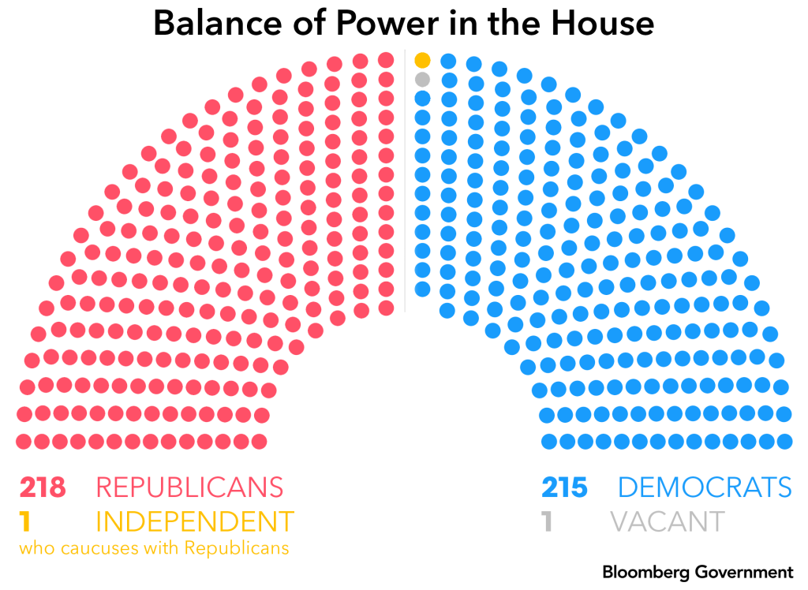
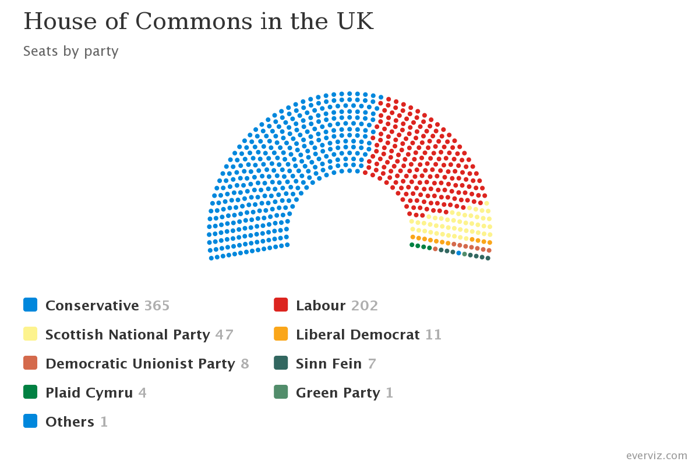
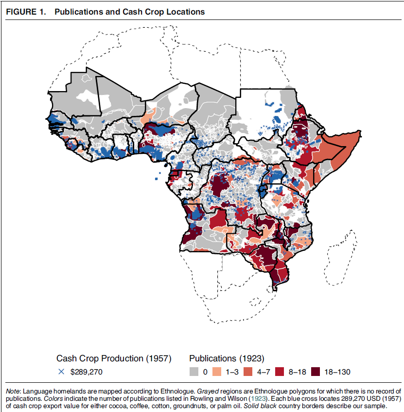
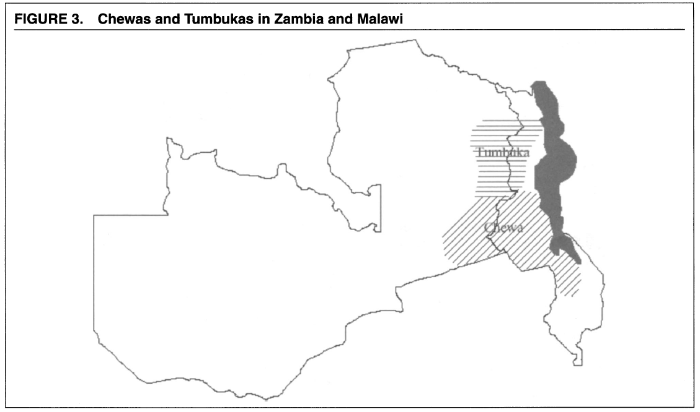
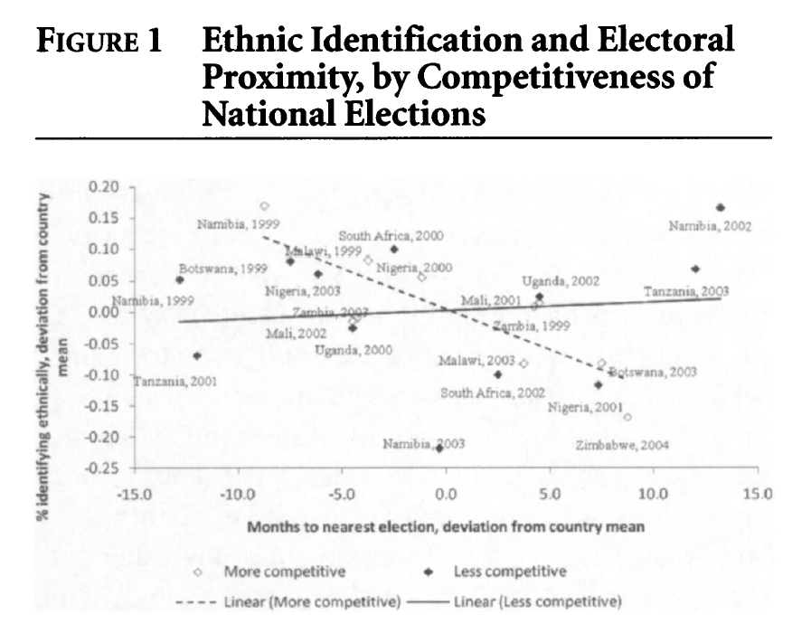
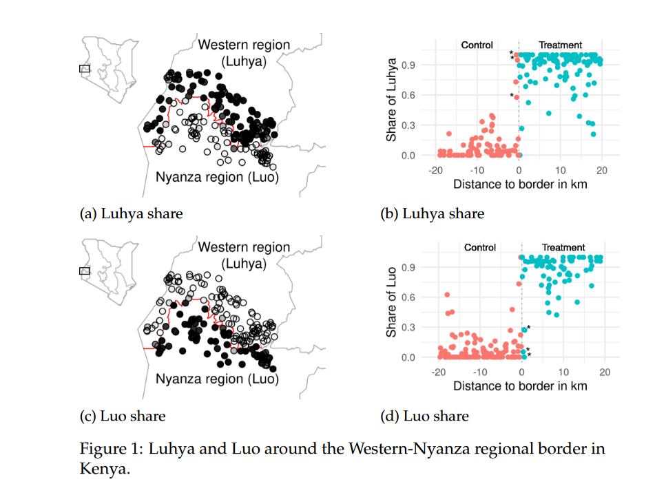

## From the First Lecture

**Q**: Why do parliaments have different numbers of parties?

:::: {.columns}

::: {.column width="30%"}

:::

::: {.column width="30%"}

:::

::: {.column width="30%"}

:::

::::

:::{.nonincremental}
- [Effective Number of Parties]{.alert} (a measure of legislative fragmentation): US, UK $\approx$ 2; Netherlands $\approx$ 8
- Are voters or parties different? Or do electoral rules matter?
:::

## From the First Lecture

**Q**: Does ethnicity matter in politics?

:::: {.columns}

::: {.column width="50%"}

:::

::: {.column width="50%"}

:::

::::

:::{.nonincremental}
- Kenya and Tanzania $\rightarrow$ geographic neighbors, same national language
- Kenya: prob. that two people vote for the same party $\uparrow$ 40pp if they are coethnics
- Tanzania: almost the same prob. between coethnics and non-coethnics
- Why do we see ethnic [cleavages]{.alert} in some countries and not others?
:::

## The "Puzzle" of Party Systems

In other words, why do countries have different [party systems]{.alert}?

$\implies$ Party system: the number and size of parties

<div style="height: 1cm;"></div>

- Are **voters** different? (E.g., they [self-identify]{.alert} differently)
- Are **politicians** different? (E.g., they care more about some voters)
- Do the **rules** of the game matter? (E.g., [electoral systems]{.alert})

<div style="height: 1cm;"></div>

. . . 

We are now able to understand how these dimensions of politics interact


## Our Plan for Today

What is a [political party]{.alert}?

- The nature and functions of parties

. . . 

Social [cleavages]{.alert} and why they matter

- Case: the origins of ethnic identities
- Overlapping vs. cross-cutting cleavages

. . . 

[Electoral institutions]{.alert} shape the interaction between voters and parties

- Mechanical and strategic effects
- From society to parties in parliament


# Parties and Cleavages: Concepts and Definitions {.section}

## What Is a Party?

> A group of officials or would-be officials who are linked with a sizeable group of citizens into an organization; a chief object of this organization is to ensure that its officials attain power or are maintained in power (Shively 2001, 234)

<div style="height: 1cm;"></div>

- **Officials** linked to **citizens** $\rightarrow$ people who vote or contribute
- **Attain power** $\rightarrow$ different from other groups such as unions or lobbies
- **Organization** $\rightarrow$ a "structured coalition" of people (not our focus here)

<div style="height: 1cm;"></div>

:::{.fragment}
The parties that exist in a country $\implies$ the party system
:::

## The Functions of Parties

> Parties are the core institution of democratic politics (Lipset 1996)

. . . 

Parties perform key functions in a democracy

- Represent, articulate, and champion the interests of the membership
- Aggregate voters' demands into a coherent agenda
- Promote political participation $\rightarrow$ "mobilize" their voters
- Organize power contestation $\rightarrow$ overcome collective action problems
- Coordinate politicians once in power


## Party Systems: A Basic Taxonomy

::::{.columns}
:::{.column width="50%"}
**Single-party systems**

- Only one party is legally allowed to hold power

- By definition, these are not democracies
:::
:::{.column width="50%"}

:::
::::


## Party Systems: A Basic Taxonomy

::::{.columns}
:::{.column width="50%"}
**One-party dominant systems**

- Multiple parties are allowed, but only one has a realistic chance of winning elections

- Classification as a democracy or dictatorship can be subtle and contested

- Is the government undermining the opposition, or is it simply more popular? 

- Cf. Rwanda vs. South Africa; the Democratic Party in the Jim Crow US South vs. the CSU in Bavaria

:::
:::{.column width="50%"}
{width=70%}

{width=70%}
:::
::::


## Party Systems: A Basic Taxonomy

::::{.columns}
:::{.column width="50%"}
**Two-party systems**

- Multiple parties exist, but only two major parties have a realistic chance of winning elections

- Cf. Democratic Party vs. Republican Party in the US; Jamaica Labour Party vs. People's National Party in Jamaica

:::
:::{.column width="50%"}

:::
::::


## Party Systems: A Basic Taxonomy

::::{.columns}
:::{.column width="50%"}
**Multiparty systems**

- More than two political parties have a realistic chance of winning elections

- They can rule separately or as part of a coalition
:::
:::{.column width="50%"}

:::
::::


## Counting Parties

- If we just counted parties running for office, most countries would be multiparty systems

- A two-party system means that only two parties can *effectively* govern

- The size of the party system $\rightarrow$ [Effective Number of Parties]{.alert}

:::{.fragment}
$ENP = \frac{1}{(\text{Vote share Party A})^2 + (\text{Vote share Party B})^2 + ... }$

using the share of total votes each party receives
:::

:::{.fragment}
:::{.nonincremental}

- Replacing votes with seats won gives us the *legislative* ENP

$ENP = \frac{1}{(\text{Seat share Party A})^2 + (\text{Seat share Party B})^2 + ... }$

using the share of total seats each party holds in parliament
:::
:::

## Counting Parties

```{r}
#| echo: false
#| fig-align: center
#| fig-width: 9.0
#| fig-height: 4.4
#| out-width: "820px"
#| out-height: "380px"

library(grid)

draw_person <- function(x, y, s = 0.05, 
                        torso_col = "#334155", 
                        head_col = "#FDE68A", 
                        collar_col = "#FFFFFF",
                        tie_col = NULL) {
  head_r <- s * 0.38
  head_y <- y + s * 0.42
  
  tx <- c(x - s * 0.62, x + s * 0.62, x + s * 0.40, x - s * 0.40)
  ty <- c(y - s * 0.50, y - s * 0.50, y + s * 0.15, y + s * 0.15)
  grid.polygon(tx, ty, gp = gpar(fill = torso_col, col = "#0F172A", lwd = 1.1))
  
  if (!is.null(collar_col)) {
    cx <- c(x - s * 0.20, x, x + s * 0.20)
    cy <- c(y + s * 0.15, y - s * 0.10, y + s * 0.15)
    grid.polygon(cx, cy, gp = gpar(fill = collar_col, col = NA))
  }
  
  if (!is.null(tie_col)) {
    tie_x <- c(x, x + s * 0.08, x, x - s * 0.08)
    tie_y <- c(y + s * 0.10, y - s * 0.15, y - s * 0.42, y - s * 0.15)
    grid.polygon(tie_x, tie_y, gp = gpar(fill = tie_col, col = "#7F1D1D", lwd = 0.6))
  }
  
  grid.circle(x, head_y, r = head_r, 
              gp = gpar(fill = head_col, col = "#0F172A", lwd = 1.1))
}

draw_hemicycle <- function(cx, cy, total_dots = 36, shares, cols) {
  arc_radii <- c(0.045, 0.072, 0.098)
  arc_counts <- c(8, 12, 16)
  
  arc_theta <- seq(pi * 0.08, pi * 0.92, length.out = 30)
  fl_x <- c(cx + 0.11 * cos(arc_theta) * 1.15, cx + 0.03 * cos(rev(arc_theta)) * 1.15)
  fl_y <- c(cy + 0.11 * sin(arc_theta) * 1.05, cy + 0.03 * sin(rev(arc_theta)) * 1.05)
  grid.polygon(fl_x, fl_y, gp = gpar(fill = "#F8FAFC", col = "#E2E8F0", lwd = 0.8))
  
  coords <- list()
  idx <- 1
  for (r_i in seq_along(arc_radii)) {
    rad <- arc_radii[r_i]
    n_d <- arc_counts[r_i]
    thetas <- seq(pi * 0.90, pi * 0.10, length.out = n_d)
    for (d in 1:n_d) {
      th <- thetas[d]
      coords[[idx]] <- list(
        x = cx + rad * cos(th) * 1.15,
        y = cy + rad * sin(th) * 1.05,
        angle = th
      )
      idx <- idx + 1
    }
  }
  
  ord <- order(sapply(coords, function(pt) pt$angle), decreasing = TRUE)
  sorted_coords <- coords[ord]
  
  party_counts <- round(shares * total_dots)
  diff <- total_dots - sum(party_counts)
  party_counts[1] <- party_counts[1] + diff
  dot_cols <- rep(cols, party_counts)
  
  grid.roundrect(cx, cy - 0.015, width = 0.045, height = 0.015, r = unit(0.004, "snpc"),
                 gp = gpar(fill = "#94A3B8", col = "#64748B", lwd = 1))
  
  for (i in 1:total_dots) {
    pt <- sorted_coords[[i]]
    grid.circle(pt$x, pt$y, r = 0.0095,
                gp = gpar(fill = dot_cols[i], col = "#0F172A", lwd = 0.7))
  }
}

grid.newpage()

panel_x <- c(0.18, 0.50, 0.82)
panel_w <- 0.30
panel_h <- 0.94

titles <- c("Two-Party", "Dominant-Party", "Multiparty")
shares_list <- list(
  c(0.50, 0.50),
  c(0.70, 0.20, 0.10),
  c(0.35, 0.30, 0.20, 0.15)
)
cols_all <- c("#2563EB", "#DC2626", "#F59E0B", "#16A34A")
labels_list <- list(
  c("50%", "50%"),
  c("70%", "20%", "10%"),
  c("35%", "30%", "20%", "15%")
)
enp_vals <- c("ENP = 2.0", "ENP = 1.9", "ENP = 3.6")
party_notes <- c("2 parties in legislature", "3 parties in legislature", "4 parties in legislature")

for (p in 1:3) {
  px <- panel_x[p]
  
  grid.roundrect(px, 0.50, width = panel_w - 0.02, height = panel_h, r = unit(0.03, "snpc"),
                 gp = gpar(fill = "#FFFFFF", col = "#E2E8F0", lwd = 1.5))
  
  grid.roundrect(px, 0.90, width = panel_w - 0.02, height = 0.10, r = unit(0.02, "snpc"),
                 gp = gpar(fill = "#F8FAFC", col = "#E2E8F0", lwd = 1))
  grid.text(titles[p], px, 0.90, gp = gpar(fontsize = 12.5, fontface = "bold", col = "#0F172A"))
  
  sh <- shares_list[[p]]
  cl <- cols_all[1:length(sh)]
  draw_hemicycle(px, 0.58, total_dots = 36, shares = sh, cols = cl)
  
  bar_y <- 0.44
  bar_w_total <- panel_w - 0.06
  bar_h <- 0.055
  bar_left <- px - bar_w_total / 2
  
  curr_x <- bar_left
  for (s_i in seq_along(sh)) {
    seg_w <- bar_w_total * sh[s_i]
    grid.rect(curr_x + seg_w / 2, bar_y, width = seg_w, height = bar_h,
              gp = gpar(fill = cl[s_i], col = "#FFFFFF", lwd = 1.2))
    grid.text(labels_list[[p]][s_i], curr_x + seg_w / 2, bar_y,
              gp = gpar(fontsize = if (sh[s_i] < 0.15) 7.5 else 9, 
                        fontface = "bold", col = "#FFFFFF"))
    curr_x <- curr_x + seg_w
  }
  
  grid.roundrect(px, 0.22, width = panel_w - 0.06, height = 0.24, r = unit(0.025, "snpc"),
                 gp = gpar(fill = if (p == 2) "#FFFBEB" else "#F1F5F9", 
                           col = if (p == 2) "#F59E0B" else "#CBD5E1", lwd = 1.5))
  
  grid.text(enp_vals[p], px, 0.26, 
            gp = gpar(fontsize = 14, fontface = "bold", 
                      col = if (p == 2) "#B45309" else "#0F172A"))
  
  grid.text(party_notes[p], px, 0.14, 
            gp = gpar(fontsize = 9.5, fontface = "plain", col = "#64748B"))
}
```


## Cleavages

Parties originate from the need for collective action to advance shared political interests

. . . 

[Cleavages]{.alert} $\rightarrow$ social divisions that can become different political camps


- Cleavages are induced by economic, cultural, and geographic differences

- If people on one side of the cleavage share the same political interests $\implies$ a party may be formed and the cleavage is "activated" or "politicized"

- Some historically relevant cleavages include:
  - Urban-rural
  - Class
  - Religious/confessional
  - Post-material

# The Origins of Party Systems {.section}

## Duverger's Theory

```{r}
#| label: duverger-textbook
#| echo: false
#| fig-align: center
#| fig-width: 8.5
#| fig-height: 5.2
#| out-width: "740px"
#| out-height: "440px"

library(grid)

grid.newpage()

# Card background with subtle rounded border
grid.roundrect(0.50, 0.50, width = 0.96, height = 0.94, r = unit(0.02, "snpc"),
               gp = gpar(fill = "#FFFFFF", col = "#CBD5E1", lwd = 1.5))

# Top black banner matching Figure 12.4
grid.roundrect(0.50, 0.915, width = 0.96, height = 0.10, r = unit(0.01, "snpc"),
               gp = gpar(fill = "#1E293B", col = NA))
grid.text("FIGURE 12.4", 0.08, 0.915, gp = gpar(fontsize = 11, fontface = "bold", col = "#FFFFFF"))
grid.rect(0.165, 0.915, width = 0.012, height = 0.025, gp = gpar(fill = "#FFFFFF", col = NA))
grid.text("Duverger's Theory: Social Cleavages and the Modifying Effect of Electoral Institutions",
          0.185, 0.915, just = "left",
          gp = gpar(fontsize = 9.2, fontface = "bold", col = "#FFFFFF"))

# Vertical main line coordinates
nx <- 0.32
y_cleav <- 0.80
y_elec  <- 0.48
y_legis <- 0.16

# Nodes: clean text exactly as in textbook
grid.text("Social cleavages", nx, y_cleav, gp = gpar(fontsize = 13, fontface = "bold", col = "#0F172A"))
grid.text("Electoral parties", nx, y_elec,  gp = gpar(fontsize = 13, fontface = "bold", col = "#0F172A"))
grid.text("Legislative parties", nx, y_legis, gp = gpar(fontsize = 13, fontface = "bold", col = "#0F172A"))

# Vertical downward arrows
arr_main <- arrow(angle = 20, length = unit(0.15, "inches"), ends = "last", type = "closed")
grid.lines(c(nx, nx), c(y_cleav - 0.035, y_elec + 0.035), arrow = arr_main,
           gp = gpar(col = "#1E293B", fill = "#1E293B", lwd = 2.2))
grid.lines(c(nx, nx), c(y_elec - 0.035, y_legis + 0.035), arrow = arr_main,
           gp = gpar(col = "#1E293B", fill = "#1E293B", lwd = 2.2))

# Modifying arrows from the right
my1 <- (y_cleav + y_elec) / 2
my2 <- (y_elec + y_legis) / 2
mx_text <- 0.54

grid.text("Strategic effect of electoral laws", mx_text, my1, just = "left",
          gp = gpar(fontsize = 11.5, col = "#0F172A"))
grid.text("Mechanical effect of electoral laws", mx_text, my2, just = "left",
          gp = gpar(fontsize = 11.5, col = "#0F172A"))

arr_mod <- arrow(angle = 20, length = unit(0.12, "inches"), ends = "last", type = "closed")
grid.lines(c(mx_text - 0.02, nx + 0.003), c(my1, my1), arrow = arr_mod,
           gp = gpar(col = "#1E293B", fill = "#1E293B", lwd = 2))
grid.lines(c(mx_text - 0.02, nx + 0.003), c(my2, my2), arrow = arr_mod,
           gp = gpar(col = "#1E293B", fill = "#1E293B", lwd = 2))

# Source
grid.text("Source: Clark, Golder, and Golder (2017), Figure 12.4", 0.95, 0.04, just = "right",
          gp = gpar(fontsize = 8.5, fontface = "italic", col = "#64748B"))

```


## Example: Ethnicity and Ethnic Parties

[Ethnicity]{.alert} $\rightarrow$ a social category defined by a set of (perceived) inherited attributes

- People are potential members of different ethnic and social groups
    - E.g., think of voters in NYC, Lagos, Jakarta
- Which of these group structures are reflected in the party system?
- Following Duverger, this depends on several interrelated processes:
    - People identify with certain groups and not others $\rightarrow$ social [cleavages]{.alert}
    - People in the same group coordinate their political behavior $\rightarrow$ ethnic [parties]{.alert}
    - Electoral institutions constrain choices $\rightarrow$ e.g., sincere or strategic voting

## The Origins of Ethnic Cleavages

Political and economic forces shaped modern ethnic identities

::::{.columns}
:::{.column width="50%"}
{width=100%}
:::
:::{.column width="50%"}
- Missionaries and colonial authorities $\rightarrow$ "created" linguistic categories by harmonizing local dialects
- Publications in local languages $\implies$ group identity and pride
- Agricultural innovations $\implies$ made ethnicity valuable to manage control of land
- Both factors $\implies$ collective identity, ethnic boundaries, and group mobilization
:::
::::

## The Origins of Ethnic Cleavages

Institutions make some cleavages more salient than others 

::::{.columns}
:::{.column width="50%"}

:::
:::{.column width="50%"}
- The main national cleavage in Nigeria is between the North (Muslim-majority) and the South (Christian-majority)
- Among the Yoruba, British colonial institutions made local ancestries more salient than religion (Laitin 1986) 
- As a result, the Yoruba are divided by religion, but this divide is not salient

:::
::::


## The Origins of Ethnic Cleavages

Colonial and post-colonial borders created new majority/minority patterns

::::{.columns}
:::{.column width="50%"}

:::
:::{.column width="50%"}
- Chewas and Tumbukas are "small" groups in Zambia but "large" groups in Malawi
- Larger size $\implies$ electoral strength, so the Chewa-Tumbuka cleavage is more salient in Malawi
- This leads to political competition and greater hostility between the two groups in Malawi
:::
::::

## The Origins of Ethnic Cleavages

Ethnicity often [overlaps]{.alert} with other cleavages 

```{r}
#| echo: false
#| fig-align: center
#| fig-width: 9.6
#| fig-height: 4.2
#| out-width: "860px"
#| out-height: "350px"

grid.newpage()

w_card <- 0.46
h_card <- 0.88
y_card <- 0.50

# -------------------------------------------------------------
# LEFT CARD: OVERLAPPING (Hausa & Igbo)
# -------------------------------------------------------------
x_left <- 0.26
grid.roundrect(x_left, y_card, width = w_card, height = h_card, r = unit(0.03, "snpc"),
               gp = gpar(fill = "#FFFFFF", col = "#CBD5E1", lwd = 1.6))

# Card Title
grid.roundrect(x_left, 0.88, width = w_card, height = 0.11, r = unit(0.02, "snpc"),
               gp = gpar(fill = "#FEF2F2", col = "#FECACA", lwd = 1.2))
grid.text("Overlapping Cleavages", x_left, 0.905, 
          gp = gpar(fontsize = 12.5, fontface = "bold", col = "#991B1B"))
grid.text("Hausa (Northern Nigeria) & Igbo (Southeastern Nigeria)", x_left, 0.852, 
          gp = gpar(fontsize = 8.5, fontface = "italic", col = "#7F1D1D"))

# Hausa Box
g1_y <- 0.64; g1_w <- w_card - 0.06; g1_h <- 0.27
grid.roundrect(x_left, g1_y, width = g1_w, height = g1_h, r = unit(0.025, "snpc"),
               gp = gpar(fill = "#F0FDF4", col = "#16A34A", lwd = 1.8))

# Tribe name to the left of the little people
grid.text("Hausa", x_left - 0.12, g1_y, gp = gpar(fontsize = 13, fontface = "bold", col = "#15803D"))

# 3 little people
dx_people <- c(-0.01, 0.07, 0.15)
for (dx in dx_people) {
  draw_person(x_left + dx, g1_y + 0.03, s = 0.065, torso_col = "#16A34A")
}

# Single common religion card for the 3 people
grid.roundrect(x_left + 0.07, g1_y - 0.065, width = 0.23, height = 0.05, r = unit(0.01, "snpc"),
               gp = gpar(fill = "#DCFCE7", col = "#16A34A", lwd = 1.3))
grid.text("Muslim", x_left + 0.07, g1_y - 0.065, gp = gpar(fontsize = 9.5, fontface = "bold", col = "#15803D"))

# The Single Divide: Just the red line
div_y <- 0.44
grid.lines(c(x_left - g1_w/2 + 0.01, x_left + g1_w/2 - 0.01), c(div_y, div_y),
           gp = gpar(col = "#DC2626", lwd = 3.5))

# Igbo Box
g2_y <- 0.24; g2_w <- w_card - 0.06; g2_h <- 0.27
grid.roundrect(x_left, g2_y, width = g2_w, height = g2_h, r = unit(0.025, "snpc"),
               gp = gpar(fill = "#EFF6FF", col = "#2563EB", lwd = 1.8))

# Tribe name to the left of the little people
grid.text("Igbo", x_left - 0.12, g2_y, gp = gpar(fontsize = 13, fontface = "bold", col = "#1D4ED8"))

# 3 little people
for (dx in dx_people) {
  draw_person(x_left + dx, g2_y + 0.03, s = 0.065, torso_col = "#2563EB")
}

# Single common religion card for the 3 people
grid.roundrect(x_left + 0.07, g2_y - 0.065, width = 0.23, height = 0.05, r = unit(0.01, "snpc"),
               gp = gpar(fill = "#DBEAFE", col = "#2563EB", lwd = 1.3))
grid.text("Christian", x_left + 0.07, g2_y - 0.065, gp = gpar(fontsize = 9.5, fontface = "bold", col = "#1D4ED8"))


# -------------------------------------------------------------
# RIGHT CARD: CROSS-CUTTING (Yorubas)
# -------------------------------------------------------------
x_right <- 0.74
grid.roundrect(x_right, y_card, width = w_card, height = h_card, r = unit(0.03, "snpc"),
               gp = gpar(fill = "#FFFFFF", col = "#CBD5E1", lwd = 1.6))

# Card Title
grid.roundrect(x_right, 0.88, width = w_card, height = 0.11, r = unit(0.02, "snpc"),
               gp = gpar(fill = "#F0FDF4", col = "#BBF7D0", lwd = 1.2))
grid.text("Cross-Cutting Cleavages", x_right, 0.905, 
          gp = gpar(fontsize = 12.5, fontface = "bold", col = "#166534"))
grid.text("Yorubas (Southwestern Nigeria)", x_right, 0.852, 
          gp = gpar(fontsize = 9.5, fontface = "italic", col = "#15803D"))

cx_m <- x_right + 0.04
cy_m <- 0.44
box_w <- 0.155; box_h <- 0.25
gap_x <- 0.015; gap_y <- 0.020

b_x1 <- cx_m - box_w/2 - gap_x/2
b_x2 <- cx_m + box_w/2 + gap_x/2
b_y1 <- cy_m + box_h/2 + gap_y/2
b_y2 <- cy_m - box_h/2 - gap_y/2

# Column Headers
grid.text("Oyo", b_x1, b_y1 + box_h/2 + 0.035,
          gp = gpar(fontsize = 11, fontface = "bold", col = "#B45309"))

grid.text("Ijebu", b_x2, b_y1 + box_h/2 + 0.035,
          gp = gpar(fontsize = 11, fontface = "bold", col = "#B45309"))

# Row Headers
row_x <- b_x1 - box_w/2 - 0.045
grid.roundrect(row_x, b_y1, width = 0.075, height = 0.055, r = unit(0.01, "snpc"),
               gp = gpar(fill = "#DCFCE7", col = "#16A34A", lwd = 1))
grid.text("Muslim", row_x, b_y1,
          gp = gpar(fontsize = 8.5, fontface = "bold", col = "#15803D"))

grid.roundrect(row_x, b_y2, width = 0.075, height = 0.055, r = unit(0.01, "snpc"),
               gp = gpar(fill = "#DBEAFE", col = "#2563EB", lwd = 1))
grid.text("Christian", row_x, b_y2,
          gp = gpar(fontsize = 8.5, fontface = "bold", col = "#1D4ED8"))

# Quadrant 1: Oyo Muslim
grid.roundrect(b_x1, b_y1, width = box_w, height = box_h, r = unit(0.015, "snpc"),
               gp = gpar(fill = "#F0FDF4", col = "#16A34A", lwd = 1.5))
draw_person(b_x1, b_y1 + 0.025, s = 0.07, torso_col = "#16A34A")
grid.text("Oyo \u2022 Muslim", b_x1, b_y1 - 0.075, gp = gpar(fontsize = 8.5, fontface = "bold", col = "#15803D"))

# Quadrant 2: Ijebu Muslim
grid.roundrect(b_x2, b_y1, width = box_w, height = box_h, r = unit(0.015, "snpc"),
               gp = gpar(fill = "#F0FDF4", col = "#16A34A", lwd = 1.5))
draw_person(b_x2, b_y1 + 0.025, s = 0.07, torso_col = "#16A34A")
grid.text("Ijebu \u2022 Muslim", b_x2, b_y1 - 0.075, gp = gpar(fontsize = 8.5, fontface = "bold", col = "#15803D"))

# Quadrant 3: Oyo Christian
grid.roundrect(b_x1, b_y2, width = box_w, height = box_h, r = unit(0.015, "snpc"),
               gp = gpar(fill = "#EFF6FF", col = "#2563EB", lwd = 1.5))
draw_person(b_x1, b_y2 + 0.025, s = 0.07, torso_col = "#2563EB")
grid.text("Oyo \u2022 Christian", b_x1, b_y2 - 0.075, gp = gpar(fontsize = 8.5, fontface = "bold", col = "#1D4ED8"))

# Quadrant 4: Ijebu Christian
grid.roundrect(b_x2, b_y2, width = box_w, height = box_h, r = unit(0.015, "snpc"),
               gp = gpar(fill = "#EFF6FF", col = "#2563EB", lwd = 1.5))
draw_person(b_x2, b_y2 + 0.025, s = 0.07, torso_col = "#2563EB")
grid.text("Ijebu \u2022 Christian", b_x2, b_y2 - 0.075, gp = gpar(fontsize = 8.5, fontface = "bold", col = "#1D4ED8"))

# Connectors: clean bidirectional arrows
arr_bi <- arrow(angle = 22, length = unit(0.07, "inches"), ends = "both", type = "closed")
grid.lines(c(b_x1 + box_w/2 - 0.01, b_x2 - box_w/2 + 0.01), c(b_y1 + 0.025, b_y1 + 0.025), arrow = arr_bi,
           gp = gpar(col = "#15803D", fill = "#15803D", lwd = 2.2))
grid.lines(c(b_x1 + box_w/2 - 0.01, b_x2 - box_w/2 + 0.01), c(b_y2 + 0.025, b_y2 + 0.025), arrow = arr_bi,
           gp = gpar(col = "#1D4ED8", fill = "#1D4ED8", lwd = 2.2))

grid.lines(c(b_x1 - box_w/2 + 0.015, b_x1 - box_w/2 + 0.015), c(b_y1 - 0.045, b_y2 + 0.045), arrow = arr_bi,
           gp = gpar(col = "#B45309", fill = "#B45309", lwd = 2.2))
grid.lines(c(b_x2 + box_w/2 - 0.015, b_x2 + box_w/2 - 0.015), c(b_y1 - 0.045, b_y2 + 0.045), arrow = arr_bi,
           gp = gpar(col = "#B45309", fill = "#B45309", lwd = 2.2))
```

Economic or territorial inequalities reinforce ethnic divisions

## The Effects of Electoral Institutions

- Ethnic identities $\rightarrow$ *potential* political cleavages

- Historical processes, economic development, and institutions can activate them politically

- Like other institutions, electoral systems also make ethnic cleavages more or less salient

- We have seen why they matter $\rightarrow$ (dis)proportionality, strategic voting

- Different electoral laws $\rightarrow$ different possibilities for ethnic cleavages to become relevant relative to other cleavages


## Mechanical Effects of Electoral Laws

Electoral laws mechanically constrain how many parties hold office

```{r}
#| echo: false
#| fig-align: center
#| fig-width: 6.8
#| fig-height: 3.8
#| out-width: "600px"
#| out-height: "320px"

grid.newpage()

grid.roundrect(0.50, 0.48, width = 0.96, height = 0.90, r = unit(0.03, "snpc"),
               gp = gpar(fill = "#FAFAFA", col = "#CBD5E1", lwd = 1.5))
grid.text("District Size = 1 (1 Seat)", 0.50, 0.87,
          gp = gpar(fontsize = 12, fontface = "bold", col = "#0F172A"))

xs <- c(0.18, 0.40, 0.62, 0.82)
cols <- c("#2563EB", "#DC2626", "#F59E0B", "#16A34A")
bg_cols <- c("#EFF6FF", "#FEF2F2", "#FFFBEB", "#F0FDF4")
shares <- c(0.40, 0.30, 0.20, 0.10)
labels <- c("40%", "30%", "20%", "10%")
n_voters <- c(4, 3, 2, 1)

grid.roundrect(xs[1], 0.75, width = 0.16, height = 0.10, r = unit(0.02, "snpc"),
               gp = gpar(fill = "#DBEAFE", col = "#2563EB", lwd = 2))
grid.text("Elected", xs[1], 0.75, gp = gpar(fontsize = 10.5, fontface = "bold", col = "#1E40AF"))

arr_up <- arrow(angle = 24, length = unit(0.14, "inches"), ends = "last", type = "closed")
grid.lines(c(xs[1], xs[1]), c(0.55, 0.69), arrow = arr_up,
           gp = gpar(col = "#2563EB", fill = "#2563EB", lwd = 4))

for (i in 1:4) {
  draw_person(xs[i], 0.46, s = 0.095, torso_col = cols[i])
  
  bar_h <- shares[i] * 0.44
  bar_y <- 0.10 + bar_h / 2
  grid.roundrect(xs[i], bar_y, width = 0.15, height = bar_h, r = unit(0.015, "snpc"),
                 gp = gpar(fill = bg_cols[i], col = cols[i], lwd = 1.8))
  grid.text(labels[i], xs[i], 0.10 + bar_h + 0.04,
            gp = gpar(fontsize = 11, fontface = "bold", col = cols[i]))
  
  nv <- n_voters[i]
  vx <- seq(xs[i] - 0.022 * (nv - 1) / 2, xs[i] + 0.022 * (nv - 1) / 2, length.out = nv)
  for (v in seq_len(nv)) {
    draw_person(vx[v], 0.13, s = 0.035, torso_col = cols[i], collar_col = NULL)
  }
}
```

:::{.nonincremental}
- SMDP favors large national parties or local majorities
- E.g., Scottish National Party (2015) $\rightarrow$ 4.7% of votes, 8.6% of seats
:::


## Strategic Effects of Electoral Laws

- Recall that disproportional systems increase strategic voting

- Voters prefer to vote for parties that have a chance of winning seats

- The same logic applies to politicians when they decide whether to run
    - If they run as a minority party under SMDP, they are unlikely to be elected
    - Even if they are elected, they will have few seats 
    - They may prefer to work within a larger party

- By contrast, in proportional systems, even small parties can enter parliament and matter for government coalitions

:::{.fragment}
$\implies$ [strategic voting]{.alert} of voters and [strategic entry]{.alert} of politicians
:::


## Duverger's Propositions

[Duverger's law]{.alert}: Single-member district plurality (SMDP) systems encourage two-party systems

[Duverger's hypothesis]{.alert}: Proportional representation electoral rules favor multiparty systems

- These propositions hold at the district level

- SMDP systems can still have multiparty systems if different parties can get strong local majorities (e.g., ethnically different regions)

. . . 

We now have an answer to why the US, the UK, and the Netherlands have different ENPs

- The SMDP system pushes *everyone* to coordinate around two big parties

- The Dutch nationwide list PR encourages many parties to run


## Duverger and Ethnic Voting

What are the implications of Duverger's theory for ethnic parties? Should we see more or fewer ethnic party systems under PR vs. SMDP?

. . . 

It depends on several factors:

- If many small groups live in mixed areas, SMDP can favor cross-ethnic coalitions

- If large groups live in separate regions, SMDP can produce large ethnic parties

- In principle, PR encourages parties to compete along other cleavages 

- However, the overlap of ethnicity, geography, and the economy may still favor ethnic parties
    - PR systems are less ethnicized (Huber 2012), but coethnic voting is not substantially lower (Müller-Crepon and Bormann 2026)

## From Parties Back to Cleavages

Given a set of rules that allocate power, parties want to maximize their support

. . . 

$\implies$ In ethnicized party systems, parties promote ethnic identification

. . . 

::::{.columns}
:::{.column width="50%"}
- The salience of ethnic identity (relative to national identity) increases in proximity to elections
- Politicians appeal to coethnics to "vote together"
- People expect that only coethnic politicians will represent their interests

:::{.fragment}
$\implies$ stronger ethnic identities and ethnic parties
:::
:::
:::{.column width="50%"}

:::
::::


## From Parties Back to Cleavages

Given a set of rules that allocate power, parties want to maximize their support

$\implies$ In ethnicized party systems, parties promote ethnic identification

. . . 

::::{.columns}
:::{.column width="50%"}
- People expect that a coethnic local government will represent them better
- They want to live in regions where their group is the majority

:::{.fragment}
$\implies$ This reinforces local majorities and provides further incentives for ethnic voting
:::
:::
:::{.column width="50%"}

:::
::::


# Summing Up {.section}


## What We Learned

A country's party system is shaped by its social heterogeneity (cleavages) and the rules that translate social demands into political power (electoral institutions)

::::{.columns}
:::{.column width="50%"}
```{r}
#| label: duverger-expanded
#| echo: false
#| fig-align: center
#| fig-width: 6.2
#| fig-height: 5.2
#| out-width: "480px"
#| out-height: "400px"

library(grid)

grid.newpage()

# Card background
grid.roundrect(0.50, 0.50, width = 0.96, height = 0.95, r = unit(0.02, "snpc"),
               gp = gpar(fill = "#FFFFFF", col = "#CBD5E1", lwd = 1.5))

# Top banner
grid.roundrect(0.50, 0.92, width = 0.96, height = 0.09, r = unit(0.01, "snpc"),
               gp = gpar(fill = "#1E293B", col = NA))
grid.text("Duverger's Theory (Expanded)", 0.50, 0.92,
          gp = gpar(fontsize = 11, fontface = "bold", col = "#FFFFFF"))

# Central vertical backbone
nx <- 0.54
y_cleav <- 0.79
y_elec  <- 0.48
y_legis <- 0.17

# Nodes
grid.text("Social cleavages", nx, y_cleav,
          gp = gpar(fontsize = 11.5, fontface = "bold", col = "#0F172A"))
grid.text("Electoral parties", nx, y_elec,
          gp = gpar(fontsize = 11.5, fontface = "bold", col = "#0F172A"))
grid.text("Legislative parties", nx, y_legis,
          gp = gpar(fontsize = 11.5, fontface = "bold", col = "#0F172A"))

# Vertical downward arrows
arr_main <- arrow(angle = 20, length = unit(0.12, "inches"), ends = "last", type = "closed")
grid.lines(c(nx, nx), c(y_cleav - 0.035, y_elec + 0.035), arrow = arr_main,
           gp = gpar(col = "#1E293B", fill = "#1E293B", lwd = 2.2))
grid.lines(c(nx, nx), c(y_elec - 0.035, y_legis + 0.035), arrow = arr_main,
           gp = gpar(col = "#1E293B", fill = "#1E293B", lwd = 2.2))

# Modifying arrows from the right
my1 <- (y_cleav + y_elec) / 2
my2 <- (y_elec + y_legis) / 2
mx_line_start <- 0.71

grid.text("Strategic effect\nof electoral laws", mx_line_start + 0.02, my1, just = "left",
          gp = gpar(fontsize = 8.5, col = "#334155", lineheight = 0.95))
grid.text("Mechanical effect\nof electoral laws", mx_line_start + 0.02, my2, just = "left",
          gp = gpar(fontsize = 8.5, col = "#334155", lineheight = 0.95))

arr_mod <- arrow(angle = 20, length = unit(0.09, "inches"), ends = "last", type = "closed")
grid.lines(c(mx_line_start, nx + 0.005), c(my1, my1), arrow = arr_mod,
           gp = gpar(col = "#475569", fill = "#475569", lwd = 1.8))
grid.lines(c(mx_line_start, nx + 0.005), c(my2, my2), arrow = arr_mod,
           gp = gpar(col = "#475569", fill = "#475569", lwd = 1.8))

# Two reverse feedback arrows (in crimson/red)
arr_feed <- arrow(angle = 20, length = unit(0.11, "inches"), ends = "last", type = "closed")

# Inner feedback loop: Electoral parties -> Social cleavages
xs_in <- c(0.39, 0.28, 0.28, 0.28, 0.39)
ys_in <- c(y_elec, y_elec, 0.635, y_cleav - 0.015, y_cleav - 0.015)
grid.xspline(xs_in, ys_in, shape = c(0, 0.7, 0, 0.7, 0), arrow = arr_feed,
             gp = gpar(col = "#DC2626", fill = "#DC2626", lwd = 2.2))

# Outer feedback loop: Legislative parties -> Social cleavages
xs_out <- c(0.37, 0.07, 0.07, 0.07, 0.39)
ys_out <- c(y_legis, y_legis, 0.48, y_cleav + 0.015, y_cleav + 0.015)
grid.xspline(xs_out, ys_out, shape = c(0, 0.7, 0, 0.7, 0), arrow = arr_feed,
             gp = gpar(col = "#DC2626", fill = "#DC2626", lwd = 2.2))

# Explanatory badge for the feedback arrows with white background
grid.roundrect(0.175, 0.635, width = 0.17, height = 0.065, r = unit(0.012, "snpc"),
               gp = gpar(fill = "#FEF2F2", col = "#DC2626", lwd = 1.2))
grid.text("Parties mobilize &\nshape identities", 0.175, 0.635,
          gp = gpar(fontsize = 8, fontface = "bold", col = "#991B1B", lineheight = 0.95))
```
:::
:::{.column width="50%"}
- Cleavages and identities $\rightarrow$ potential parties
- Electoral rules $\rightarrow$ effective parties
  - Strategic and mechanical effects
- Parties $\rightarrow$ shape both cleavages and electoral rules to advance their interests
:::
::::

## 

::: {style="display: flex; justify-content: center; align-items: center; height: 70vh; font-size: 2.5em; font-weight: bold; color: Black;"}
Thank you!
:::