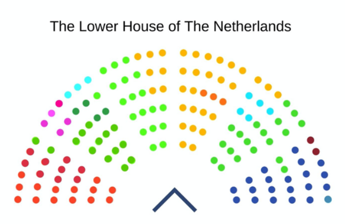
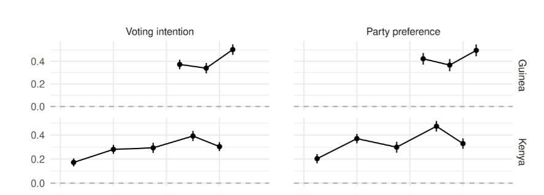
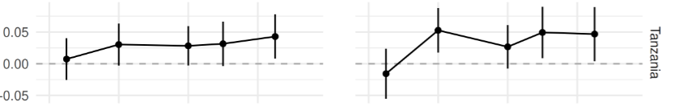
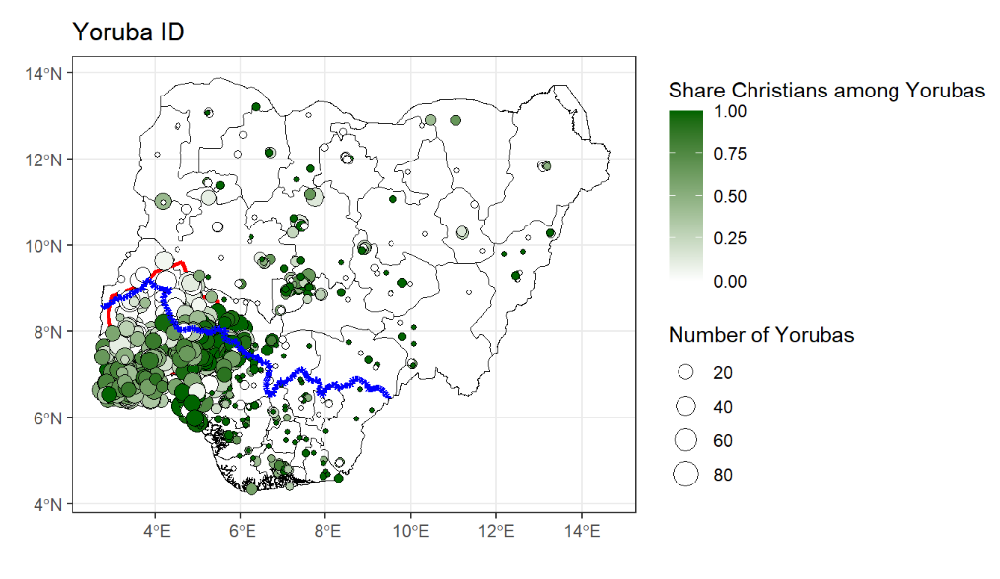

## From the First Lecture

**Q**: Why do Parliaments have different numbers of parties?

:::: {.columns}

::: {.column width="30%"}

:::

::: {.column width="30%"}

:::

::: {.column width="30%"}

:::

::::

:::{.nonincremental}
- [Effective Number of Parties]{.alert} (a measure of Parliament fragmentation): US, UK $\approx$ 2; Netherlands $\approx$ 8
- Are voters or parties different? Or do the vote rules matter?
:::

## From the First Lecture

**Q**: Does ethnicity matter in politics?

:::: {.columns}

::: {.column width="50%"}

:::

::: {.column width="50%"}

:::

::::

:::{.nonincremental}
- Kenya and Tanzania $\rightarrow$ geographic neighbors, same national language
- Kenya: prob. that two people vote the same party $\uparrow$ 40pp if they are coethnics
- Tanzania: almost same prob. between coethnics and non-coethnics
- Why do we see ethnic *cleavages* in some countries and not others?
:::

## The "Puzzle" of Party Systems

Why do different countries have different different [party systems]{.alert}?

$\implies$ Party system: the number and size of parties

- Are **voters** different? (E.g., they [self-identify]{.alert} differently)
- Are the **politicians** different? (E.g., they care about some interests or others)
- Do the **rules** of the game matter? (E.g., [electoral system]{.alert})

. . . 

Now we are able to understand how these dimensions of politics interact

## Our Plan for Today

What is a [political party]{.alert} 

- The nature and functions of parties

. . . 

Social [cleavages]{.alert} and why they matter

- Overlapping vs cross-cutting cleavages
- "Activating" cleavages $\rightarrow$ the origins of ethnic identities

. . . 

How electoral institutions shape the interaction between voters and parties

- Mechanical and strategic effects
- From society to legislative parties

# Parties and Cleavages: Concepts and Definitions {.section}

## What is a Party

> A group of officials or would-be officials who are linked with a sizeable group of citizens into an organization; a chief object of this organization is to ensur that its officials attain power or are maintained in power (Shively 2001, 234)

- **Officials** linked to **citizens** $\rightarrow$ people who vote or contribute
- **Attain power** $\rightarrow$ different from other groups such as unions or lobbies
- **Organization** $\rightarrow$ a "structured coalition" of people (not our focus here)

:::{.fragment}
The parties that exist in a country $\implies$ the party system
:::

## The Functions of Parties

> Parties are the core institution of democratic politics (Lipset 1996)

- Represent, articulate, and champion the interests of the membership
- Aggregate demands of voters into coherent agenda
- Promote political participation $\rightarrow$ "mobilize" their voters
- Organize power contestation $\rightarrow$ overcome collective action problems
- Coordinate politicians once in power

## Party Systems: A Basic Taxonomy

::::{.columns}
:::{.column width="50%"}
**Single-party systems**

- Only one party is legally allowed to hold power

- This means not being a democracy
:::
:::{.column width="50%"}
[figure tba: china]
:::
::::

## Party Systems: A Basic Taxonomy

::::{.columns}
:::{.column width="50%"}
**One-party dominant systems**

- Multiple parties allowed, but only one has realistic chances of getting power

- Classification as democracy/dictatorship can be subtle and contested

- Is the government undermining the opposition or is it simply more popular? 
    - Cf. regional governments: Democratic Party in Jim Crow US South, CSU in Bavaria, etc

:::
:::{.column width="50%"}
[figure tba: rwanda, ANC, ldp japan, congress party india]
:::
::::

## Party Systems: A Basic Taxonomy

::::{.columns}
:::{.column width="50%"}
**Two-party systems**

- Only two major parties have a realistic chance of holding power

- Even if many parties compete for office, only two can realistically make it

:::
:::{.column width="50%"}
[figure tba: US, Jamaica]
:::
::::

## Party Systems: A Basic Taxonomy

::::{.columns}
:::{.column width="50%"}
**Multiparty systems**

- More than two political parties have a realistic chance of holding power

- They can rule separately or as part of a coalition
:::
:::{.column width="50%"}
[figure tba: spain, netherlands]
:::
::::

## Counting Parties

- If we just counted parties running for office, most countries would be multiparty systems

- A two-party system $\rightarrow$ only two parties can *effectively* govern

- To account for the effective size of the party system $\rightarrow$ [Effective Number of Parties]{.alert}

:::{.fragment}
$ENP = \frac{1}{(\text{Vote share Party A})^2 + (\text{Vote share Party B})^2 + ... }$
:::

:::{.fragment}
:::{.nonincremental}
- Replacing the Vote share with the Seat share in legislature $\rightarrow$ Effective Number of *legislative* parties
:::
:::

## Counting Parties

[placeholder for illustration of the ENP (same party colors) under different configurations of seats in the legislature]

## Cleavages

Origins of parties $\rightarrow$ origins of different political interests

. . . 

[Cleavages]{.alert} $\rightarrow$ social divisions that can become different political camps

- Cleavages are induced by economic, cultural, geographic differences

- If people on one side of the cleavage share the same political interests $\implies$ a party may be formed and the cleavage is "activated" or "politicized"

# The Origins of Party Systems {.section}

## Duverger's Theory

[placeholder for figure 12.4]

## Example: Ethnicity and Ethnic Parties

[Ethnicity]{.alert} $\rightarrow$ a social category defined by a set of (perceived) inherited attributes

[placeholder for figure]

- People are potential members of different ethnic and social groups
    - E.g., think of voters in NYC, Lagos, Jakarta
- We will ask why party systems may (or may not) represent a country's ethnic divisions 

## The Origins of Ethnic Cleavages

In the colonial period, political and economic forces shape the formation of modern ethnic identities

::::{.columns}
:::{.column width="50%"}
{width=100%}
:::
:::{.column width="50%"}
- Missionaries and colonial authorities $\rightarrow$ "create" linguistic categories from disparate dialects
- Agricultural innovations $\rightarrow$ ethnicity valuable to manage control of land
:::
::::

## The Origins of Ethnic Cleavages

Colonial institutions made some cleavages more salient than others 

::::{.columns}
:::{.column width="50%"}

:::
:::{.column width="50%"}
- The main cleavage in Nigeria is between North (Muslim-majority) and South (Christian-majority)
- Unlike other major groups, the Yorubas are religiously heterogeneous
- During colonialism, political institutions made ancestral city affiliation more salient than religion (Laitin 1986) 
:::
::::

## The Origins of Ethnic Cleavages

Colonial (and post-colonial) borders created new majority/minority patterns

::::{.columns}
:::{.column width="50%"}

:::
:::{.column width="50%"}
- Chewas and Tumbukas are "small" groups in Zambia but "large" groups in Malawi
- Group size $\implies$ groups can compete for power
- In Malawi, where they are both relevant, more political competition and hostility
:::
::::

## From Social to Political Cleavagess

- overlapping and cross-cutting cleavages 

## The Effects of Electoral Institutions

## Mechanical Effects of Electoral Laws

## Strategic Effects of Electoral Laws

## Duverger's Propositions

[Duverger's law]{.alert}: Single-member district plurality (SMDP) systems encourage two-party systems

[Duverger's hypothesis]{.alert}: Proportional representation electoral rules favor multiparty systems

## From Parties Back to Cleavages

- reverse causality: politicians make ethnic identities more salient

(Muller-Crepon, Eifert et al)

# Summing Up {.section}

## What We Learned

## 

::: {style="display: flex; justify-content: center; align-items: center; height: 70vh; font-size: 2.5em; font-weight: bold; color: Black;"}
Thank you!
:::