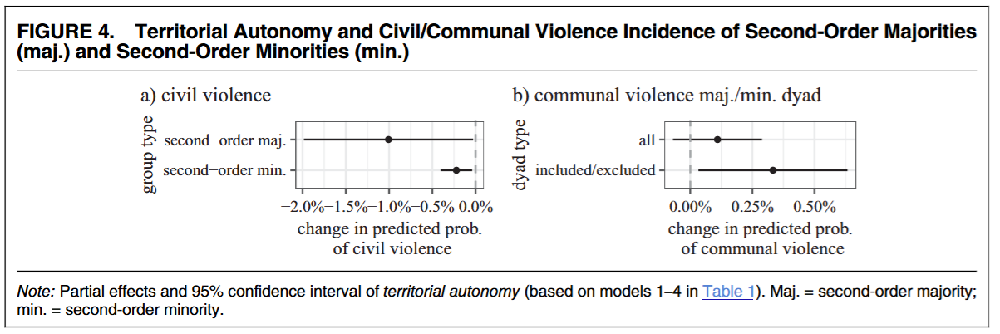

```{r}
#| include: false
library(grid)

render_table_14_1 <- function(step) {
  rows <- list(
    list("Electoral system",  "Majoritarian",                      "Proportional",            "Proportional",                      "Majoritarian"),
    list("Party system",      "Two parties",                       "Many parties",            "Two parties",                       "Many parties"),
    list("Government type",   "Single-party majority",             "Coalition/minority",      "Coalition/minority",                "Single-party majority"),
    list("Federalism",        "Unitary",                           "Federal",                 "Federal",                           "Unitary"),
    list("Bicameralism",      "Unicameral",                        "Bicameral",               "Unicameral",                        "Bicameral"),
    list("Constitutionalism", "Legislative supremacy constitution", "Higher law constitution", "Higher law constitution",           "Legislative supremacy constitution")
  )
  
  html <- c(
    '<div style="width: 92%; margin: 0 auto; font-size: 0.72em;">',
    '<div style="background-color: #1E293B; color: #FFFFFF; padding: 8px 14px; font-weight: bold; border-radius: 4px 4px 0 0;">',
    'TABLE 14.1 &#9632; Institutions and the Majoritarian-Consensus Dimension',
    '</div>',
    '<table style="width: 100%; border-collapse: collapse; background: #FFFFFF; text-align: left;">',
    '<thead>',
    '<tr style="background-color: #475569; color: #FFFFFF;">',
    '<th style="padding: 8px 12px; border: 1px solid #CBD5E1; width: 26%;">Institution</th>',
    '<th style="padding: 8px 12px; border: 1px solid #CBD5E1; width: 37%;">Majoritarian</th>',
    '<th style="padding: 8px 12px; border: 1px solid #CBD5E1; width: 37%;">Consensus</th>',
    '</tr>',
    '</thead>',
    '<tbody>'
  )
  
  max_row <- min(step, 6)
  for (i in 1:max_row) {
    bg <- if (i %% 2 == 0) "#F8FAFC" else "#FFFFFF"
    inst <- rows[[i]][[1]]
    if (i < step) {
      c1 <- rows[[i]][[2]]
      c2 <- rows[[i]][[3]]
      style_cell <- "padding: 8px 12px; border: 1px solid #E2E8F0;"
    } else {
      c1 <- '<span style="color: #94A3B8; font-weight: bold;">?</span>'
      c2 <- '<span style="color: #94A3B8; font-weight: bold;">?</span>'
      bg <- "#FEFCE8"
      style_cell <- "padding: 8px 12px; border: 1px solid #E2E8F0;"
    }
    html <- c(html, sprintf(
      '<tr style="background-color: %s;"><td style="%s font-weight: 600;">%s</td><td style="%s">%s</td><td style="%s">%s</td></tr>',
      bg, style_cell, inst, style_cell, c1, style_cell, c2
    ))
  }
  
  html <- c(html, '</tbody></table>')
  
  if (step <= 6) {
    opt1 <- rows[[step]][[4]]
    opt2 <- rows[[step]][[5]]
    html <- c(html, sprintf(
      '<div style="margin-top: 16px; padding: 10px 16px; background: #F1F5F9; border-left: 4px solid #2563EB; border-radius: 4px; font-size: 0.95em;"><strong>Place for %s:</strong> &nbsp; <span style="background: #FFFFFF; padding: 3px 10px; border: 1px solid #CBD5E1; border-radius: 4px; margin-right: 8px;">%s</span> <span style="background: #FFFFFF; padding: 3px 10px; border: 1px solid #CBD5E1; border-radius: 4px;">%s</span></div>',
      rows[[step]][[1]], opt1, opt2
    ))
  }
  
  html <- c(html, '</div>')
  paste(html, collapse = "\n")
}
```


## Course Evaluations

Please take 10 minutes to fill out the course evaluation forms

## Motivation

We have learned that there are many [varieties of democracy]{.alert}

- [Types of government]{.alert}: Presidential vs. Parliamentary systems
- [Electoral laws]{.alert}: Majoritarian vs. Proportional
- [Party systems]{.alert}: Two-party vs. Multiparty
- [Veto players]{.alert}: Federal vs. Unitary, Unicameral vs. Bicameral

. . . 

We can see these institutions as different ways to distribute political power

- That is, we can classify these classifications
- What are the consequences of these institutions for democracy and conflict?

## Our Plan for Today

[Majoritarian]{.alert} vs. [Consensus]{.alert} democracies

- Two visions of democracy
- Broadly speaking: [dispersed]{.alert} vs. [concentrated]{.alert} power
- Encompasses all the institutions that we have seen so far 

. . . 

Democratic institutions and [ethnic conflict]{.alert}

- What are the causes of ethnic conflict?
- Can political institutions prevent ethnic conflict?
- A closer look: electoral laws and federalism


# Majoritarian and Consensus Democracy {.section}


## Majoritarian Democracy

One vision of democracy

- Elections are events in which citizens choose (two) alternative "teams"
- The team that wins an electoral majority governs
- The goal of elections is to produce a governing majority
    - The majority is built *at election time*, when the "teams" form and coalitions of citizens vote  
    - Minority (opposition) groups should not be involved in policy-making

:::{.fragment}
$\implies$ Power is concentrated within election cycles, few checks and balances

$\implies$ Power is shared *over time*: if voters are dissatisfied, the opposition can win the next time
:::


## Consensus Democracy

A different vision of democracy

- Elections are events in which citizens choose representatives from a wide range of social groups
- Representatives bargain over policy on their behalf
- The goal of elections is to reflect the society's composition
    - The majority is built *after elections* by party coalitions
    - Social minorities should influence policy-making

:::{.fragment}
$\implies$ Power is dispersed within election cycles

$\implies$ Majorities are constrained through checks and balances
:::

## Summarizing Variation in Institutions

```{r}
#| echo: false
#| results: asis
cat(render_table_14_1(1))
```

## Summarizing Variation in Institutions

```{r}
#| echo: false
#| results: asis
cat(render_table_14_1(2))
```

## Summarizing Variation in Institutions

```{r}
#| echo: false
#| results: asis
cat(render_table_14_1(3))
```

## Summarizing Variation in Institutions

```{r}
#| echo: false
#| results: asis
cat(render_table_14_1(4))
```

## Summarizing Variation in Institutions

```{r}
#| echo: false
#| results: asis
cat(render_table_14_1(5))
```

## Summarizing Variation in Institutions

```{r}
#| echo: false
#| results: asis
cat(render_table_14_1(6))
```

## Summarizing Variation in Institutions

```{r}
#| echo: false
#| results: asis
cat(render_table_14_1(7))
```

## Is There a "Correct" Vision?

By now, it should be clear that these visions entail trade-offs

- Majority $\rightarrow$ focus on clear responsibilities and voter control
    - But: voters have fewer choices, and minorities stay out until the next time
- Consensus $\rightarrow$ focus on broad representation and continuous bargaining
    - But: the government can be more unstable and the status quo more difficult to change

. . . 

Choosing one form over the other is a matter of ideological preferences and political culture

- Cf. the debate on democratic backsliding: how do we recognize it?

# Electoral Laws, Federalism, and Ethnic Conflict

## Ethnic Diversity and Conflict: A Long-Standing Question

Ethnic conflict is tragically present in our collective memory


- Despite its salience, ethnic conflict is in fact relatively rare
- Political scientists are interested in its causes (why do we see ethnic conflict in some countries and not others)

## Ethnic Fractionalization and Conflict

Ethnic [fractionalization]{.alert} $\rightarrow$ many medium/small ethnic groups

```{r}
#| echo: false
#| fig-align: center
#| fig-width: 8.2
#| fig-height: 2.8
#| out-width: "760px"
#| out-height: "255px"

grid.newpage()
arr <- arrow(angle = 20, length = unit(0.11, "inches"), ends = "last", type = "closed")

grid.roundrect(0.24, 0.45, width = 0.36, height = 0.68, r = unit(0.025, "snpc"),
               gp = gpar(fill = "#F8FAFC", col = "#CBD5E1", lwd = 1.6))
grid.text("Low Fractionalization", 0.24, 0.88, gp = gpar(fontsize = 11.5, fontface = "bold", col = "#0F172A"))

cols_low <- c(rep("#2563EB", 10), rep("#F59E0B", 2))
xs_g <- rep(seq(0.115, 0.365, length.out = 4), each = 3)
ys_g <- rep(c(0.60, 0.45, 0.30), 4)
for (i in 1:12) {
  grid.circle(xs_g[i], ys_g[i], r = 0.032, gp = gpar(fill = cols_low[i], col = "#FFFFFF", lwd = 1.2))
}

grid.lines(c(0.44, 0.56), c(0.45, 0.45), arrow = arr, gp = gpar(col = "#475569", fill = "#475569", lwd = 2.5))

grid.roundrect(0.76, 0.45, width = 0.36, height = 0.68, r = unit(0.025, "snpc"),
               gp = gpar(fill = "#F8FAFC", col = "#CBD5E1", lwd = 1.6))
grid.text("High Fractionalization", 0.76, 0.88, gp = gpar(fontsize = 11.5, fontface = "bold", col = "#0F172A"))

cols_high <- c("#2563EB", "#2563EB", "#F59E0B", "#F59E0B",
               "#16A34A", "#16A34A", "#DC2626", "#DC2626",
               "#9333EA", "#9333EA", "#0D9488", "#0D9488")
xs_g2 <- rep(seq(0.635, 0.885, length.out = 4), each = 3)
for (i in 1:12) {
  grid.circle(xs_g2[i], ys_g[i], r = 0.032, gp = gpar(fill = cols_high[i], col = "#FFFFFF", lwd = 1.2))
}
```

- Fractionalization correlates with fewer public goods (Easterly and Levine 1997)
- The proposed mechanism is govt instability and policy disagreements
- Fractionalization can affect conflict through economic channels

## Ethnic Polarization and Conflict

Ethnic [polarization]{.alert} $\rightarrow$ two large ethnic groups

```{r}
#| echo: false
#| fig-align: center
#| fig-width: 8.2
#| fig-height: 2.8
#| out-width: "760px"
#| out-height: "255px"

grid.newpage()
arr <- arrow(angle = 20, length = unit(0.11, "inches"), ends = "last", type = "closed")

grid.roundrect(0.24, 0.45, width = 0.36, height = 0.68, r = unit(0.025, "snpc"),
               gp = gpar(fill = "#F8FAFC", col = "#CBD5E1", lwd = 1.6))
grid.text("Low Polarization", 0.24, 0.88, gp = gpar(fontsize = 11.5, fontface = "bold", col = "#0F172A"))

xs_g <- rep(seq(0.115, 0.365, length.out = 4), each = 3)
ys_g <- rep(c(0.60, 0.45, 0.30), 4)
cols_high <- c("#2563EB", "#2563EB", "#F59E0B", "#F59E0B",
               "#16A34A", "#16A34A", "#DC2626", "#DC2626",
               "#9333EA", "#9333EA", "#0D9488", "#0D9488")
for (i in 1:12) {
  grid.circle(xs_g[i], ys_g[i], r = 0.032, gp = gpar(fill = cols_high[i], col = "#FFFFFF", lwd = 1.2))
}

grid.lines(c(0.44, 0.56), c(0.45, 0.45), arrow = arr, gp = gpar(col = "#475569", fill = "#475569", lwd = 2.5))

grid.roundrect(0.76, 0.45, width = 0.36, height = 0.68, r = unit(0.025, "snpc"),
               gp = gpar(fill = "#F8FAFC", col = "#CBD5E1", lwd = 1.6))
grid.text("High Polarization", 0.76, 0.88, gp = gpar(fontsize = 11.5, fontface = "bold", col = "#0F172A"))

xs_g2 <- rep(seq(0.635, 0.885, length.out = 4), each = 3)
cols_pol <- c(rep("#2563EB", 6), rep("#DC2626", 6))
for (i in 1:12) {
  x_adj <- if (i <= 6) xs_g2[i] - 0.01 else xs_g2[i] + 0.01
  grid.circle(x_adj, ys_g[i], r = 0.032, gp = gpar(fill = cols_pol[i], col = "#FFFFFF", lwd = 1.2))
}
grid.lines(c(0.76, 0.76), c(0.20, 0.70), gp = gpar(col = "#DC2626", lwd = 2, lty = "dashed"))
```

- Polarization is conducive to conflict (Montalvo and Reynal-Querol 2005)
- Especially when a large group is denied democratic access to power 
- Fractionalization could *reduce* it by favoring intergroup alliances

## The Problem of Endogeneity

The [constructivist]{.alert} tradition provides an important insight

```{r}
#| echo: false
#| fig-align: center
#| fig-width: 8.4
#| fig-height: 2.8
#| out-width: "780px"
#| out-height: "255px"

grid.newpage()
arr <- arrow(angle = 20, length = unit(0.11, "inches"), ends = "last", type = "closed")

grid.roundrect(0.20, 0.45, width = 0.28, height = 0.66, r = unit(0.025, "snpc"),
               gp = gpar(fill = "#F8FAFC", col = "#CBD5E1", lwd = 1.6))
grid.text("Heterogeneous", 0.20, 0.87, gp = gpar(fontsize = 11, fontface = "bold", col = "#0F172A"))

xs_c1 <- rep(seq(0.12, 0.28, length.out = 3), each = 3)
ys_c1 <- rep(c(0.58, 0.45, 0.32), 3)
cols_mix <- c("#2563EB", "#2563EB", "#2563EB",
              "#F59E0B", "#F59E0B", "#16A34A",
              "#DC2626", "#9333EA", "#0D9488")
for (i in 1:9) {
  grid.circle(xs_c1[i], ys_c1[i], r = 0.032, gp = gpar(fill = cols_mix[i], col = "#FFFFFF", lwd = 1.2))
}

grid.lines(c(0.35, 0.42), c(0.45, 0.45), arrow = arr, gp = gpar(col = "#1E293B", fill = "#1E293B", lwd = 2.2))
grid.roundrect(0.50, 0.45, width = 0.14, height = 0.36, r = unit(0.02, "snpc"),
               gp = gpar(fill = "#1E293B", col = NA))
grid.text("Common\nInstitutions", 0.50, 0.45, gp = gpar(fontsize = 9.5, fontface = "bold", col = "#FFFFFF"))
grid.lines(c(0.58, 0.65), c(0.45, 0.45), arrow = arr, gp = gpar(col = "#1E293B", fill = "#1E293B", lwd = 2.2))

grid.roundrect(0.80, 0.45, width = 0.28, height = 0.66, r = unit(0.025, "snpc"),
               gp = gpar(fill = "#EFF6FF", col = "#2563EB", lwd = 1.8))
grid.text("Assimilation / Change", 0.80, 0.87, gp = gpar(fontsize = 11, fontface = "bold", col = "#1E40AF"))

xs_c2 <- rep(seq(0.72, 0.88, length.out = 3), each = 3)
for (i in 1:9) {
  grid.circle(xs_c2[i], ys_c1[i], r = 0.032, gp = gpar(fill = "#2563EB", col = "#FFFFFF", lwd = 1.2))
}
```

- Identities *change* in response to institutions and conflicts
- Different institutions can affect conflict by changing the identities (or cleavages) that are activated

## The Problem of Endogeneity

Even with a constructivist mindset, the problem remains thorny

```{r}
#| echo: false
#| fig-align: center
#| fig-width: 8.6
#| fig-height: 3.6
#| out-width: "780px"
#| out-height: "320px"

grid.newpage()
arr_bi <- arrow(angle = 20, length = unit(0.09, "inches"), ends = "both", type = "closed")

grid.roundrect(0.50, 0.80, width = 0.24, height = 0.28, r = unit(0.02, "snpc"),
               gp = gpar(fill = "#F8FAFC", col = "#475569", lwd = 1.8))
grid.text("Institutions", 0.50, 0.88, gp = gpar(fontsize = 11, fontface = "bold", col = "#0F172A"))
grid.polygon(c(0.44, 0.50, 0.56), c(0.79, 0.83, 0.79), gp = gpar(fill = "#475569", col = NA))
for (cx_col in c(0.455, 0.485, 0.515, 0.545)) {
  grid.rect(cx_col, 0.745, width = 0.012, height = 0.07, gp = gpar(fill = "#475569", col = NA))
}
grid.rect(0.50, 0.70, width = 0.12, height = 0.018, gp = gpar(fill = "#475569", col = NA))

grid.roundrect(0.22, 0.24, width = 0.24, height = 0.32, r = unit(0.02, "snpc"),
               gp = gpar(fill = "#EFF6FF", col = "#2563EB", lwd = 1.8))
grid.text("Ethnic Identities", 0.22, 0.34, gp = gpar(fontsize = 11, fontface = "bold", col = "#1E40AF"))
grid.circle(0.16, 0.20, r = 0.024, gp = gpar(fill = "#2563EB", col = NA))
grid.circle(0.20, 0.20, r = 0.024, gp = gpar(fill = "#2563EB", col = NA))
grid.circle(0.25, 0.20, r = 0.024, gp = gpar(fill = "#F59E0B", col = NA))
grid.circle(0.29, 0.20, r = 0.024, gp = gpar(fill = "#16A34A", col = NA))

grid.roundrect(0.78, 0.24, width = 0.24, height = 0.32, r = unit(0.02, "snpc"),
               gp = gpar(fill = "#FEF2F2", col = "#DC2626", lwd = 1.8))
grid.text("Ethnic Conflict", 0.78, 0.34, gp = gpar(fontsize = 11, fontface = "bold", col = "#991B1B"))
grid.circle(0.71, 0.20, r = 0.024, gp = gpar(fill = "#2563EB", col = NA))
grid.circle(0.85, 0.20, r = 0.024, gp = gpar(fill = "#F59E0B", col = NA))
grid.lines(c(0.755, 0.805), c(0.175, 0.225), gp = gpar(col = "#DC2626", lwd = 3))
grid.lines(c(0.755, 0.805), c(0.225, 0.175), gp = gpar(col = "#DC2626", lwd = 3))

grid.lines(c(0.355, 0.645), c(0.24, 0.24), arrow = arr_bi,
           gp = gpar(col = "#1E293B", fill = "#1E293B", lwd = 2.4))
grid.lines(c(0.27, 0.39), c(0.42, 0.64), arrow = arr_bi,
           gp = gpar(col = "#1E293B", fill = "#1E293B", lwd = 2.4))
grid.lines(c(0.61, 0.73), c(0.64, 0.42), arrow = arr_bi,
           gp = gpar(col = "#1E293B", fill = "#1E293B", lwd = 2.4))
```

- Risk of conflict means that identities are already formed and solid
- Defuse identities and promote a broader one, or take them as given and promote interethnic cooperation? E.g., Rwanda vs. Burundi (King and Samii 2020)


## Electoral Laws and Ethnic Conflict

The debate on electoral laws reflects the two visions of democracy

- Consensus $\rightarrow$ reproduce divisions, promote compromise after elections
- Majority $\rightarrow$ defuse divisions, promote alliances at election time

. . . 

[Consociationalism]{.alert} (Lijphart) $\rightarrow$ strong consensus institutions in divided societies

- Netherlands: Calvinists, Catholics, Socialists, Liberals
- Lebanon: Maronite Christians, Sunni Muslims, Shia Muslims
    - Top govt roles, legislative seats, judiciary all split between groups
- [Proportional representation]{.alert} is the recommended electoral law

## Electoral Laws and Ethnic Conflict

Criticisms of consociationalism

- Promotes fragmentation at the cost of instability
- Unclear incentives for cooperation in the legislature
- Majorities can be dependent on small, possibly extremist parties

. . . 

An alternative (Majority vision) could be Alternative Vote (Horowitz 1985)

- Majoritarian system with candidates' ranking
- Candidates need many second, third... preferences to win
- This would push them to make broad cross-ethnic appeals


## Federalism and Ethnic Conflict

Recall the discussion on federalism in the previous lecture

- Federalism's appeal $\rightarrow$ defusing conflict through autonomy and self-government
    - Language policy, education, fiscal policy, etc.

- On the other hand, federalism may fuel ethnic divisions
    - Entrenches ethnic leaders and reinforces identities
    - Can be a starting point for demands for further concessions

## Federalism and Ethnic Conflict

Federalism can also shift the conflict to the local level



:::{.nonincremental}
- Regional majorities can exclude regional minorities
- Minority representation at the federal level may be needed to balance powers and attenuate conflict
:::


## Other Institutional Solutions

Other institutions that promote interethnic social ties can prevent conflict

```{r}
#| echo: false
#| fig-align: center
#| fig-width: 7.6
#| fig-height: 3.4
#| out-width: "700px"
#| out-height: "310px"

grid.newpage()
arr_bi <- arrow(angle = 20, length = unit(0.08, "inches"), ends = "both", type = "closed")

grid.roundrect(0.50, 0.50, width = 0.78, height = 0.78, r = unit(0.08, "snpc"),
               gp = gpar(fill = "#F8FAFC", col = "#475569", lwd = 2))

grid.roundrect(0.25, 0.49, width = 0.20, height = 0.52, r = unit(0.04, "snpc"),
               gp = gpar(fill = "#EFF6FF", col = "#2563EB", lwd = 1.8))
grid.text("French", 0.25, 0.81, gp = gpar(fontsize = 10, fontface = "bold", col = "#1E40AF"))

grid.roundrect(0.56, 0.58, width = 0.34, height = 0.36, r = unit(0.04, "snpc"),
               gp = gpar(fill = "#FFFBEB", col = "#D97706", lwd = 1.8))
grid.text("German", 0.56, 0.81, gp = gpar(fontsize = 10, fontface = "bold", col = "#B45309"))

grid.roundrect(0.62, 0.27, width = 0.24, height = 0.19, r = unit(0.04, "snpc"),
               gp = gpar(fill = "#F0FDF4", col = "#16A34A", lwd = 1.8))
grid.text("Italian", 0.44, 0.27, gp = gpar(fontsize = 10, fontface = "bold", col = "#15803D"))

pts <- list(
  c(0.22, 0.60, "#2563EB"),
  c(0.26, 0.38, "#2563EB"),
  c(0.48, 0.62, "#D97706"),
  c(0.64, 0.54, "#D97706"),
  c(0.57, 0.27, "#16A34A"),
  c(0.68, 0.27, "#16A34A")
)

ties <- list(
  c(1, 3), c(2, 3), c(2, 5), c(3, 5), c(4, 6), c(1, 4)
)
for (t in ties) {
  p1 <- as.numeric(pts[[t[1]]][1:2])
  p2 <- as.numeric(pts[[t[2]]][1:2])
  dx <- p2[1] - p1[1]; dy <- p2[2] - p1[2]
  d <- sqrt(dx^2 + dy^2)
  ux <- dx / d; uy <- dy / d
  pad <- 0.032
  grid.lines(c(p1[1] + pad * ux, p2[1] - pad * ux),
             c(p1[2] + pad * uy, p2[2] - pad * uy),
             arrow = arr_bi, gp = gpar(col = "#475569", fill = "#475569", lwd = 1.7))
}

for (p in pts) {
  grid.circle(as.numeric(p[1]), as.numeric(p[2]), r = 0.025,
              gp = gpar(fill = p[3], col = "#FFFFFF", lwd = 1.5))
}
```

- In Switzerland, interethnic networks were a bulwark against ethnonationalism (Wimmer 2011)
- In Nigeria, a civil service program brought people to other regions and improved national pride (Okunogbe 2022)

# Summing Up {.section}


## What We Learned

- Different views of democracy answer the question "What should democracy do?"

- Concentrate power with clear mandates or disperse power with broad influence

- Societies have tried different institutions to prevent conflict

- "Which institutions work best?" is still largely an open question

- Institutions are developed to solve existing conflicts and prevent future ones

- This is still an active area (see Prof. Strijbis' project)


## 

::: {style="display: flex; justify-content: center; align-items: center; height: 70vh; font-size: 2.5em; font-weight: bold; color: Black;"}
Thank you!
:::